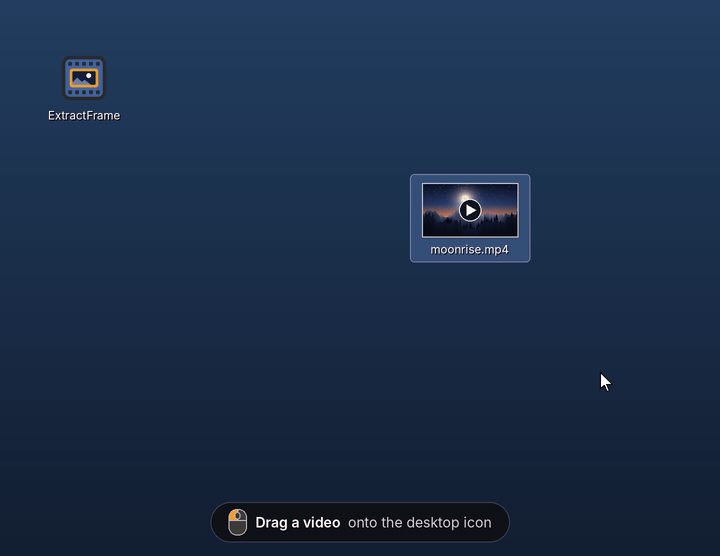

# Extract Frame — Frame-Exact Video to PNG Extractor

> **Note:** This repository serves as a visual and technical showcase of a custom desktop utility. Source code and binaries are kept private.

## SETUP (once)
1. Unzip this folder somewhere permanent, e.g.  C:\Tools\ExtractFrame
   (keep ExtractFrame.bat, ExtractFrame.ps1 and ExtractFrame.ico together).
2. Right-click ExtractFrame.bat > Show more options > Send to > Desktop (create shortcut).
3. Optional, for the nice icon: right-click the new desktop shortcut > Properties >
   Change Icon... > Browse > pick ExtractFrame.ico in this folder > OK.
4. Needs ffmpeg. If it isn't installed, the first run offers to install it with winget
   (just press Enter). Or put ffmpeg.exe and ffprobe.exe next to the script.

## USE
- Drag a video file (or several) onto the desktop icon.
- The frame viewer opens on the first frame. Find the frame you want and press Enter.
- The PNG is saved next to the video, named like  myvideo_f0074.png
- Double-clicking the icon without a video does nothing useful: always drop a video on it.

## Viewer Controls

| Input | Action |
| :--- | :--- |
| **`Left` / `Right` Arrows or Scroll Wheel** | Step backward or forward by 1 frame |
| **`Up` / `Down` Arrows** | Jump 10 frames forward or backward |
| **`Shift` + `Left` / `Right` Arrows** | Jump 1 second forward or backward |
| **Drag Orange Bar** | Scrub quickly across the timeline |
| **`Home` / `End`** | Jump to first or last frame |
| **`Enter` or `S`** | Save current frame as a lossless PNG |
| **`Esc`** | Close the viewer |

 The frame number and timecode (H:MM:SS:FF) are shown under the picture,
  and "saved ..." appears there after each save.

## TYPING MODE (optional)

Open ExtractFrame.ps1 in Notepad and change
    $OpenViewerOnDrop = $true    to    $OpenViewerOnDrop = $false
Now dropping a video opens a console where you type what you want:

## Typing Mode Commands

| Command | Action |
| :--- | :--- |
| `0:00:03` | Jump to a specific time (`H:MM:SS`) |
| `00:03.5` | Jump to minutes and seconds with a fraction |
| `0:00:03:12` | Jump to exact timecode (e.g., 3 seconds + 12 frames) |
| `3s` or `3.5s` | Jump to a specific timestamp in seconds |
| `72` or `f72` | Extract a specific frame number |
| `72-80` | Batch export a frame range (one PNG per frame) |
| `0:00:03?` or `72-95?` | Generate a labeled contact sheet for that second or range so you can pick a frame (max 60 frames per sheet) |
| `v` or `v 0:00:03` | Open the interactive frame viewer (optionally at a specific timestamp) |
| *(Empty)* + `Enter` | Finish session and close the window |

## Configuration Settings (`ExtractFrame.ps1`)

| Setting | Default | Description |
| :--- | :--- | :--- |
| `$FirstFrame` | `0` | `0` uses standard FFmpeg numbering; set to `1` to match Nuke's default Read node numbering. |
| `$ColorMatrix` | `'auto'` | Uses the video's color tag (untagged HD defaults to `bt709`, SD to `bt601`). Can be forced to `'bt709'`, `'bt601'`, or `'bt2020'`. |
| `$OpenViewerOnDrop` | `$true` | Opens the visual viewer on drop (`$true`), or launches straight into console typing mode (`$false`). |

## NOTES
- Frame-exact: the saved PNG is the true frame, not the nearest keyframe.
- 10/12-bit sources are saved as 16-bit PNG, 8-bit sources as 8-bit PNG.
- The viewer shows JPEG previews for speed; the saved PNG is always full quality.
- Saving the same frame again overwrites the earlier PNG.
