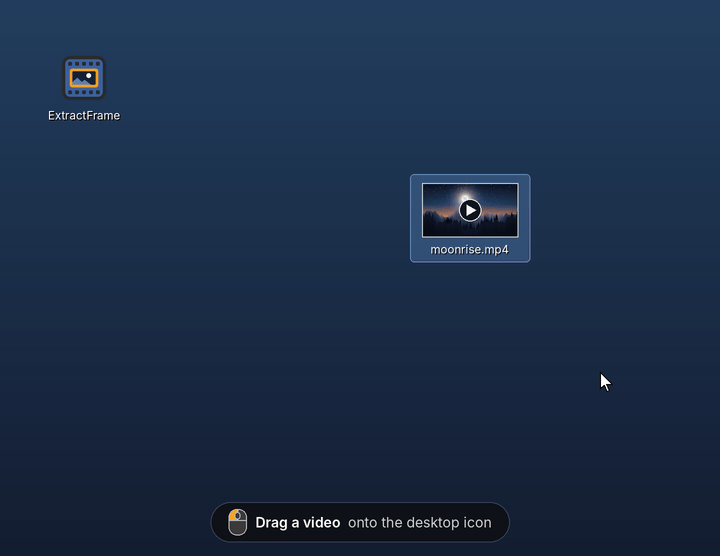

# EXTRACT FRAME - grab a frame-exact PNG from a video

> **Note:** This repository serves as a visual and technical showcase of a custom desktop utility. Source code and binaries are kept private.


## UPDATING
Just replace `ExtractFrame.ps1` (or the whole folder). Your shortcut keeps working.

## SETUP (once)
1. Unzip this folder somewhere permanent, e.g. `C:\Tools\ExtractFrame` (keep `ExtractFrame.bat`, `ExtractFrame.ps1` and `ExtractFrame.ico` together).
2. Right-click `ExtractFrame.bat` > Show more options > Send to > Desktop (create shortcut).
3. Optional, for the nice icon: right-click the new desktop shortcut > Properties > Change Icon... > Browse > pick `ExtractFrame.ico` in this folder > OK.
4. Needs ffmpeg. If it isn't installed, the first run offers to install it with winget (just press Enter). Or put `ffmpeg.exe` and `ffprobe.exe` next to the script.

## USE
* Drag a video file (or several) onto the desktop icon.
* The frame viewer opens on the first frame. Find the frame you want and press Enter.
* The PNG is saved next to the video, named like `myvideo_f0074.png`
* Double-clicking the icon without a video does nothing useful: always drop a video on it.

## VIEWER CONTROLS

| Control | Action |
| :--- | :--- |
| **Left / Right arrows** | step one frame |
| **Shift + Left / Right** | jump one second |
| **Up / Down arrows** | jump 10 frames forward / back |
| **Scroll wheel** | step one frame |
| **Drag the orange bar** | scrub through the video |
| **Home / End** | first / last frame |
| **`Enter` or `S`** | save this frame as a PNG |
| **`Esc`** | close the viewer |

The frame number and timecode (H:MM:SS:FF) are shown under the picture, and "saved ..." appears there after each save.

## TYPING MODE (optional)

Open `ExtractFrame.ps1` in Notepad and change
```powershell
OpenViewerOnDrop = true    to    OpenViewerOnDrop = false
```
Now dropping a video opens a console where you type what you want:

| Input | Action |
| :--- | :--- |
| `0:00:03` | a time (H:MM:SS) |
| `00:03.5` | minutes:seconds with a fraction |
| `0:00:03:12` | timecode: 3 seconds + 12 frames |
| `3s` or `3.5s` | seconds |
| `72` or `f72` | a frame number |
| `72-80` | a range: one PNG per frame |
| `0:00:03?` or `72-95?` | contact sheet: every frame of that second (or range), each labelled with its number, opens so you can pick one (max 60 frames per sheet) |
| `v` or `v 0:00:03` | open the frame viewer (at that time) |
| *(empty)* `Enter` | done, closes the window |

## SETTINGS (top of ExtractFrame.ps1)

| Setting | Description |
| :--- | :--- |
| `$FirstFrame = 0` | 0 = ffmpeg numbering. Set to 1 to match Nuke's default Read node numbering. |
| `$ColorMatrix = 'auto'` | uses the video's color tag; untagged HD gets bt709, SD gets bt601. Force with 'bt709', 'bt601' or 'bt2020'. |
| `$OpenViewerOnDrop = $true` | viewer on drop ($true) or typing mode ($false). |

## NOTES
* Frame-exact: the saved PNG is the true frame, not the nearest keyframe.
* 10/12-bit sources are saved as 16-bit PNG, 8-bit sources as 8-bit PNG.
* The viewer shows JPEG previews for speed; the saved PNG is always full quality.
* Saving the same frame again overwrites the earlier PNG.
